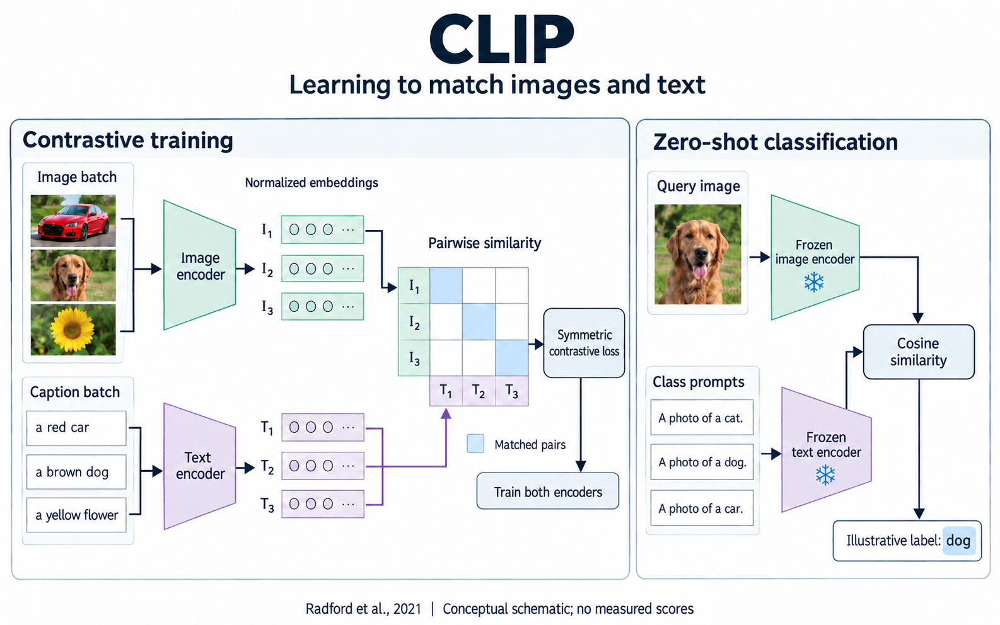
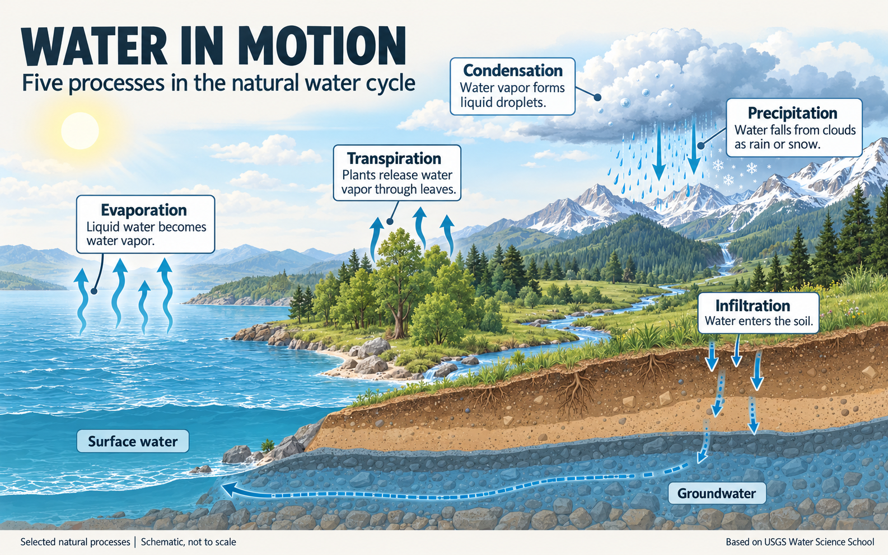
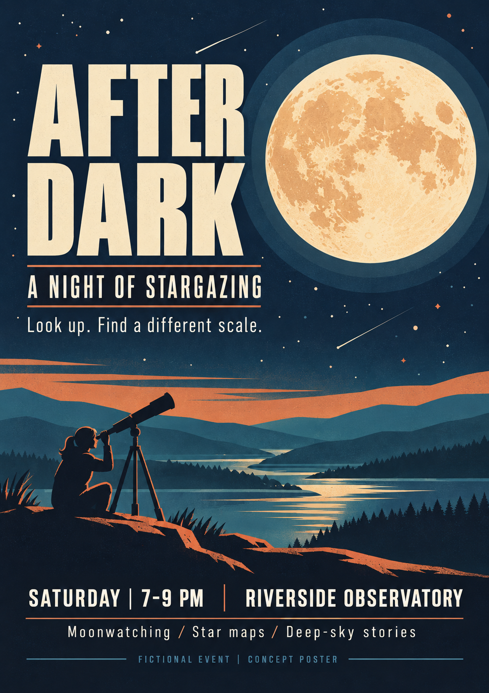
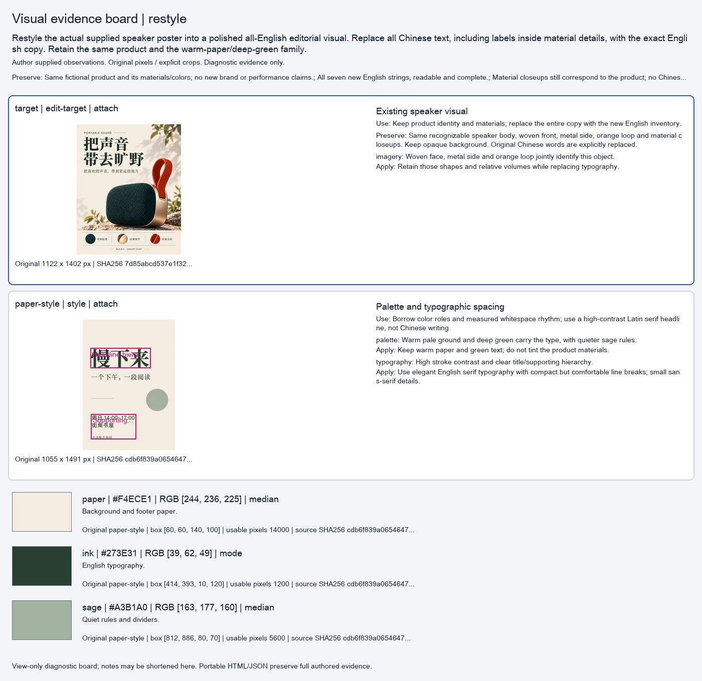
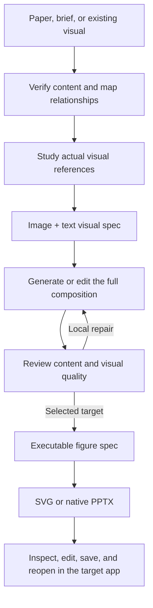

<div align="center">

# Image2Editable

**Turn images, papers, and ideas into editable visual designs.**

[English](README.md) · [简体中文](README.zh-CN.md)

[](CHANGELOG.md)
[](LICENSE)
[](#quick-start)

[Gallery](#gallery) · [Quick start](#quick-start) · [Workflow](#workflow) · [Examples](docs/examples.md) · [Runtime and exports](docs/runtime.md)

</div>

Image2Editable is an agent skill for **reconstructing figures, designing new visuals, and learning from style references**. It connects content analysis, visual design, and reconstruction into editable text, shapes, paths, and reusable components.

Use it for paper frameworks, scientific explainers, posters, and product visuals. The workflow supports **Affinity, Adobe Illustrator, and PowerPoint**, with a shared drawing spec for SVG and native PPTX output.

## Gallery

Four English examples from the current v4.2.1 workflow. Click an image for the full resolution.

<table>
  <tr>
    <td width="50%" align="center"><a href="assets/gallery/clip.png"></a><br><strong>CLIP</strong><br>Scientific framework · new composition</td>
    <td width="50%" align="center"><a href="assets/gallery/water-cycle.png"></a><br><strong>Water in Motion</strong><br>Science explainer · new composition</td>
  </tr>
  <tr>
    <td width="50%" align="center"><a href="assets/gallery/speaker.png"></a><br><strong>Take the Long Way.</strong><br>Product editorial · existing-image restyle</td>
    <td width="50%" align="center"><a href="assets/gallery/night-poster.png"></a><br><strong>After Dark</strong><br>Event poster · new composition</td>
  </tr>
</table>

**Gallery stage:** these four examples are reviewed **PNG visual targets**. They have not been reconstructed into editable native projects. The [case notes](docs/examples.md) include prompts, sources, and the CLIP repair history. A separate [executable SVG example](examples/renderer-demo/rendered/figure.svg) demonstrates the drawing-spec path.

## What you can do

| Start with | Ask Image2Editable to | Get |
|---|---|---|
| A paper figure or screenshot | Measure its layout, sample colors, extract useful assets, and reconstruct it against the original | An editable figure with traceable geometry and review notes |
| A paper or method description | Check the method, map its content and relations, study relevant visual references, and design a framework | A reviewed visual target, followed by an editable project when requested |
| A brief | Design a poster, scientific explainer, or product visual | A full composition with planned typography and image placement |
| An existing image and references | Learn selected palette, typography, layout, or imagery traits and adapt them to the target | A restyled image or revised editable project |
| An analyzed figure spec | Extract modules, colors, and text styles into reusable catalogs | Component SVGs, JSON inventories, ASE swatches, and optional PPTX catalog pages |

### Reference learning with an image + text spec

References stay visible throughout the process. The visual spec can include original images, annotated regions, local samples, color swatches, and written adaptation decisions.

- **Study the reference:** identify what makes its hierarchy, spacing, palette, and imagery work.
- **Choose what transfers:** apply the useful traits to the new content while preserving facts and required text.
- **Pass the actual images:** attach the selected source images or crops to generation together with the written analysis.
- **Keep the evidence:** save the image + text record as portable HTML and JSON.

For example, the speaker study samples **`#F4ECE1`** for the paper ground, **`#273E31`** for the main ink, and **`#A3B1A0`** for supporting rules. Sampling boxes and median/mode methods are recorded. These are measured reference colors, not a guarantee of exact RGB throughout a generated image.

[Inspect the speaker visual spec](examples/style-study-speaker/visual-spec.json) · [Download/open its HTML locally](examples/style-study-speaker/visual-spec.html)

<details>
<summary>See the reference, annotation, and palette evidence board</summary>



The board is a compact diagnostic view. The HTML and JSON preserve the complete observations.

</details>

## Quick start

**Best-supported environment:** Codex with local file access, image inspection, and an image-generation tool. Native application review also needs the relevant application and a working control mechanism. See [runtime requirements](docs/runtime.md) before requesting PPTX export.

### 1. Install the skill

Clone the repository, then install a local skill symlink on macOS/Linux:

```bash
git clone https://github.com/guangzhaoli/image2editable.git
cd image2editable
```

From the repository root:

```bash
mkdir -p "$HOME/.agents/skills"
ln -s "$PWD/skills/image2editable" "$HOME/.agents/skills/image2editable"
```

Keep the repository at that location. The command does not replace an existing installation. Codex discovers local skills from `~/.agents/skills`; if the skill does not appear, restart Codex. See the [official skill documentation](https://learn.chatgpt.com/docs/build-skills).

You can also ask your agent to install the `skills/image2editable` folder from this checkout. Other Agent Skills hosts may load the instructions, but their image-generation and application-control integrations need separate validation.

### 2. Attach your inputs and describe the outcome

```text
Use $image2editable to recreate the attached paper figure in PowerPoint.
Keep the original layout and exact labels. Make text and diagram shapes
individually editable. Deliver the PPTX, a PNG preview, and review notes.
```

```text
Use $image2editable to read this paper and design an English method figure.
Check the pipeline and relationships, study relevant architecture diagrams,
create an image-and-text visual spec, then build and review the visual target.
Reconstruct the selected design as editable SVG.
```

```text
Use $image2editable to improve my poster using these two references.
Learn the palette and typography from the first, and the layout rhythm
from the second. Preserve my subject and exact wording.
```

Mention your **target application, exact copy, dimensions, and elements to preserve** when they matter. Both English and Chinese briefs are supported.

### 3. Try the drawing helpers independently

The included synthetic example runs with Node.js and does not need image generation:

```bash
node skills/image2editable/scripts/render_figure.mjs \
  examples/renderer-demo/figure-spec.json --check

node skills/image2editable/scripts/render_figure.mjs \
  examples/renderer-demo/figure-spec.json \
  --out _build/svg-demo --format svg
```

Output directories must be new, so a rerun cannot overwrite manual edits. [More commands and dependencies](docs/runtime.md).

## Workflow

For new designs and substantial restyling:



**Faithful reconstruction** starts with measured geometry, sampled colors, extracted assets, and an aligned original underlay. It preserves the reference layout unless a redesign is requested. Simple diagrams and local edits can take a direct vector or native route.

The project uses three records with different purposes:

| Record | Purpose |
|---|---|
| `design-plan.json` | Content evidence, claims, nodes, relationships, and design decisions |
| `visual-spec.json` + `visual-spec.html` | Actual references, visual observations, annotated samples, palette, and adaptation choices |
| `figure-spec.json` | Executable coordinates, text, styles, assets, groups, and connections consumed by the drawing backends |

**Content, appearance, and editability are reviewed separately.** Successful generation or export does not certify all three.

## Editable output and application support

| Target | Output route |
|---|---|
| **Affinity** | SVG/PDF interchange, followed by native editing and saving in the installed application |
| **Adobe Illustrator** | SVG/PDF interchange or available native scripting, followed by `.ai` saving in Illustrator |
| **PowerPoint** | Native PPTX text boxes, shapes, groups, paths, and local image assets |

## Components and palettes

Once a figure has a verified drawing spec, build a reusable catalog:

```bash
node skills/image2editable/scripts/build_library.mjs \
  examples/renderer-demo/figure-spec.json --out _build/library-demo
```

This produces component SVGs, catalog boards, `library.json`, `palette.json`, `text-styles.json`, and `palette.ase`. Optional PPTX catalog pages use the same runtime as PPTX figure export.

[Browse the generated example library](examples/renderer-demo/library/library.json) · [Preview its component board](examples/renderer-demo/library/boards/01-components.svg)

Extraction begins with analyzed objects in the spec. It is not an automatic segmentation tool for arbitrary photos. Catalogs are editable snapshots; native Symbols, Assets panels, global colors, and theme bindings require application-specific setup.

## Repository map

```text
image2editable/
├── README.md / README.zh-CN.md
├── skills/image2editable/       # SKILL.md, reference guides, scripts, fixtures
├── assets/gallery/             # Actual generated example images
├── examples/
│   ├── english-cases/          # Briefs, prompts, review summaries
│   ├── style-study-speaker/    # Portable image + text visual spec
│   └── renderer-demo/          # Executable spec, SVG, component library
└── docs/                       # Examples, runtime, README research, launch copy
```

## Contributing

Useful contributions include clear failure cases, better visual references, renderer improvements, and application compatibility checks. Please include the input, expected behavior, actual output, environment, and a concrete observation. Keep scientific correctness and editability distinct from aesthetic preference. See [CONTRIBUTING.md](CONTRIBUTING.md).

## Acknowledgements

[Editable Design](https://github.com/yejy53/Editable-Design) helped inform the practice of developing a complete visual target before editable reconstruction. Image2Editable adapts that idea to a shared SVG/PPTX drawing spec and native-application review. See the [design research notes](skills/image2editable/references/design-research.md) for additional influences and their scope.

The README structure draws on [Superpowers](https://github.com/obra/superpowers), [Anthropic Skills](https://github.com/anthropics/skills), and the concise installation framing of [OpenAI Skills](https://github.com/openai/skills). The latter is now deprecated; current installation guidance is checked separately. [Research and adaptation notes](docs/readme-research.md).

Gallery content references include the [CLIP paper](https://proceedings.mlr.press/v139/radford21a.html), [USGS water-cycle material](https://www.usgs.gov/media/images/water-cycle-png), and [NASA/JPL's Grand Tour poster](https://www.jpl.nasa.gov/images/the-grand-tour-jpl-travel-poster/) for visual style. These sources do not endorse this project.

## License

Project code and documentation are released under the **[MIT License](LICENSE)**. External papers, reference designs, software, and other third-party materials retain their own terms. See [THIRD_PARTY_NOTICES.md](THIRD_PARTY_NOTICES.md) for gallery provenance and the boundary of this release.
