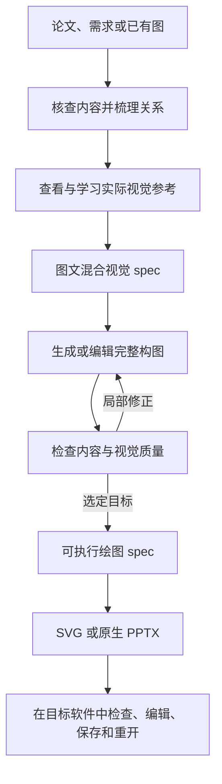

<div align="center">

# Image2Editable

**把图片、论文和想法，变成可以继续编辑的视觉设计。**

[English](README.md) · [简体中文](README.zh-CN.md)

[](CHANGELOG.md)
[](LICENSE)
[](#快速开始)

[效果展示](#效果展示) · [快速开始](#快速开始) · [工作流程](#工作流程) · [案例记录](docs/examples.md) · [运行环境与导出](docs/runtime.md)

</div>

Image2Editable 是一个用于**图形复刻、自主设计和参考风格学习**的 Agent Skill。它把内容分析、视觉设计和可编辑重建串起来，帮助你得到能够继续修改的文字、形状、路径与组件。

它适合论文框架图、科普图、poster 和产品图文，支持 **Affinity、Adobe Illustrator、PowerPoint** 工作流，并通过统一绘图 spec 输出 SVG 与原生对象 PPTX。

## 效果展示

以下是当前 v4.2.1 流程实际生成的四个英文案例。点击图片查看原始分辨率。

<table>
  <tr>
    <td width="50%" align="center"><a href="assets/gallery/clip.png"></a><br><strong>CLIP</strong><br>论文框架图 · 自主设计</td>
    <td width="50%" align="center"><a href="assets/gallery/water-cycle.png"></a><br><strong>Water in Motion</strong><br>科普信息图 · 自主设计</td>
  </tr>
  <tr>
    <td width="50%" align="center"><a href="assets/gallery/speaker.png"></a><br><strong>Take the Long Way.</strong><br>产品图文 · 已有图风格优化</td>
    <td width="50%" align="center"><a href="assets/gallery/night-poster.png"></a><br><strong>After Dark</strong><br>活动海报 · 自主设计</td>
  </tr>
</table>

**案例阶段说明：** 这四张是经过审查的 **PNG 视觉目标稿**，尚未重建为可编辑原生工程。[案例记录](docs/examples.md)包含提示词、来源和 CLIP 的修订过程。另附一个[可执行 SVG 示例](examples/renderer-demo/rendered/figure.svg)，展示统一绘图 spec 的渲染路线。

## 可以做什么

| 你提供 | Image2Editable 做什么 | 你得到 |
|---|---|---|
| 论文图或截图 | 分析布局、测量坐标、取色、提取素材，对照原图重建 | 带几何依据和审查记录的可编辑图 |
| 论文或方法描述 | 核查方法、梳理内容关系、学习同类图的视觉表达，再设计框架图 | 经审查的视觉目标，以及按需重建的可编辑工程 |
| 创作需求 | 设计 poster、科普信息图或产品图文 | 具有完整构图、文字层级和图像组织的视觉作品 |
| 已有图与参考图 | 学习指定的配色、字体气质、布局或图像表达，适配到你的内容 | 风格优化后的图像或可编辑工程 |
| 已分析的绘图 spec | 提取模块、颜色和文字样式，整理成复用清单 | 组件 SVG、JSON 清单、ASE 色板及可选 PPTX 目录页 |

### 用图文混合 spec 学习参考

参考图会保留在设计过程中。视觉 spec 可以同时记录原图、区域标注、局部样本、色板和文字分析。

- **分析参考：** 识别层级、间距、配色和图像表达中值得学习的部分。
- **确定适配：** 把这些特征用到新的内容上，保留事实、指定文字和需要保持的元素。
- **实际附图：** 将选定原图或裁切与文字分析一起交给生成工具。
- **保存依据：** 输出可以本地查看的 HTML 和结构化 JSON。

例如，音箱案例从参考图测得纸色 **`#F4ECE1`**、主文字色 **`#273E31`**、辅助线色 **`#A3B1A0`**，同时记录采样框和中位数／众数方法。这些是参考图中的实测颜色，不代表生成结果每个像素都严格等于对应色号。

[查看音箱视觉 spec](examples/style-study-speaker/visual-spec.json) · [下载后在本地打开 HTML](examples/style-study-speaker/visual-spec.html)

<details>
<summary>展开查看参考图、布局标注与配色证据板</summary>


证据板用于紧凑预览，完整观察记录保存在 HTML 和 JSON 中。

</details>

## 快速开始

**主要验证环境：** 具备本地文件访问、读图和图像生成工具的 Codex。原生软件验收还需要安装对应应用，并具备可用的控制方式。需要 PPTX 时，请先看[运行环境说明](docs/runtime.md)。

### 1. 安装技能

克隆仓库，再通过符号链接安装到 macOS/Linux 的本地技能目录：

```bash
git clone https://github.com/guangzhaoli/image2editable.git
cd image2editable
```

在仓库根目录执行：

```bash
mkdir -p "$HOME/.agents/skills"
ln -s "$PWD/skills/image2editable" "$HOME/.agents/skills/image2editable"
```

请保留仓库所在位置。命令不会替换同名的已有安装。Codex 从 `~/.agents/skills` 发现本地技能；如果没有出现，可以重启 Codex。参见[官方技能文档](https://learn.chatgpt.com/docs/build-skills)。

也可以让 agent 安装本地仓库中的 `skills/image2editable` 文件夹。其他支持 Agent Skills 的工具可以读取这些指令，但图像生成和应用控制集成需要另外验证。

### 2. 附上输入，说明想得到什么

```text
使用 $image2editable，把附件中的论文图复刻到 PowerPoint。
保留原始布局和精确标签，文字和模块都能单独修改。
交付 PPTX、PNG 预览和审查说明。
```

```text
使用 $image2editable，阅读这篇论文并设计一张英文方法框架图。
先核查 pipeline 和内容关系，再学习相关架构图的视觉表达，
形成图文混合 spec，生成并审查完整视觉目标，最后重建为可编辑 SVG。
```

```text
使用 $image2editable，根据这两张参考图优化我的 poster。
学习第一张的配色和字体气质，学习第二张的布局节奏。
保留我的主题、主体身份和精确文案。
```

有明确要求时，请给出**目标软件、精确文字、尺寸，以及必须保持的元素**。支持中文和英文需求。

### 3. 独立运行绘图辅助程序

仓库自带一个合成示例，使用 Node.js 即可运行，不需要调用图像生成工具：

```bash
node skills/image2editable/scripts/render_figure.mjs \
  examples/renderer-demo/figure-spec.json --check

node skills/image2editable/scripts/render_figure.mjs \
  examples/renderer-demo/figure-spec.json \
  --out _build/svg-demo --format svg
```

输出目录必须是新目录，避免重新生成时覆盖手工修改。[更多命令与依赖说明](docs/runtime.md)。

## 工作流程

自主设计和较大范围的风格调整采用以下流程：



**忠实复刻**从原图测量、取色、素材提取与原位贴底开始，除非用户要求重新设计，否则保留参考布局。简单图和局部修改可以直接走矢量或原生编辑路线。

三个记录各自负责不同内容：

| 记录 | 用途 |
|---|---|
| `design-plan.json` | 内容证据、事实、节点、关系与设计决策 |
| `visual-spec.json` + `visual-spec.html` | 实际参考、视觉观察、区域样本、配色与适配方案 |
| `figure-spec.json` | 供绘图后端执行的坐标、文字、样式、素材、分组与连线 |

**内容正确、视觉合适、对象可编辑分别验收。** 生成成功或导出成功，不能代替这三项检查。

## 可编辑输出与软件支持

| 目标软件 | 输出路线 | 需要检查 |
|---|---|---|
| **Affinity** | SVG/PDF 交换文件，再在已安装应用中编辑、保存原生工程 | 文字、曲线、字体、效果与原生重开 |
| **Adobe Illustrator** | SVG/PDF 交换文件，或可用的原生脚本，最终在 Illustrator 中保存 `.ai` | 可编辑文字与字形路径、图层、路径与原生重开 |
| **PowerPoint** | 原生 PPTX 文本框、形状、分组、路径与局部图像素材 | 单独改字和移动对象、字体排版、保存重开与导出 |

当前自动 PPTX 后端依赖宿主提供的 **`@oai/artifact-tool`** 运行时，本仓库不附带这个运行时。SVG 和 spec 检查只需要 Node.js。Affinity 和 Illustrator 采用导入后编辑、验收的工作流，渲染器不直接写出它们的专有原生格式。

照片、纹理、科学图像和生成插画可以作为栅格素材保留在可编辑构图中；转曲公式仍然是可缩放路径。固定连接路径不会随模块拖动自动重新布线，原生软件中的手工修改也不会自动回写 spec。

## 组件库与配色列表

有了核对过的绘图 spec，就可以生成复用清单：

```bash
node skills/image2editable/scripts/build_library.mjs \
  examples/renderer-demo/figure-spec.json --out _build/library-demo
```

输出包含组件 SVG、目录页、`library.json`、`palette.json`、`text-styles.json` 和 `palette.ase`。可选的 PPTX 目录页与图形导出使用同一运行时。

[查看已生成的示例组件库](examples/renderer-demo/library/library.json) · [预览组件目录页](examples/renderer-demo/library/boards/01-components.svg)

提取从 spec 中已经分析好的对象开始，不是对任意照片执行自动分层。目录中的组件是可编辑快照；原生 Symbols、Assets 面板、全局色与主题绑定需要在对应应用中另外建立。

## 验证情况与当前边界

- **四个英文视觉案例：** 三张新图、一张已有图优化。三张采用首稿，CLIP 经三轮局部修正。提示词与逐例观察见[案例记录](docs/examples.md)。
- **科学图仍需要审查：** CLIP 首稿的文字看起来合理，但连线有误；选定版本已分开两种模态的输入，并让结果来自相似度计算。
- **生成结果会变化：** 本组案例是探索性测试，不是受控 benchmark、语言对照，也不保证每次都达到发表标准。
- **能力依赖运行环境：** skill 负责组织宿主提供的工具，不包含图像模型、应用授权或原生软件自动化工具。
- **精确信息需要依据：** 缺失的实验数值、看不清的标签和无法读取的来源，会被记录为未知，不会静默补造。

## 仓库结构

```text
image2editable/
├── README.md / README.zh-CN.md
├── skills/image2editable/       # SKILL.md、参考指南、脚本、合成样例
├── assets/gallery/             # 实际生成的案例图片
├── examples/
│   ├── english-cases/          # 需求、提示词、审查摘要
│   ├── style-study-speaker/    # 可本地打开的图文混合 spec
│   └── renderer-demo/          # 可执行 spec、SVG、组件库
└── docs/                       # 案例、运行环境、README 调研、发布文案
```

公开技能名称是 **`image2editable`**，流程沿用原有 **paper-figure-replica v4.2.1**。此次公开改名保留绘图 schema 和渲染算法。

## 参与改进

欢迎提供清楚的失败案例、更好的视觉参考、渲染改进和应用兼容性验证。请附上输入、预期行为、实际输出、运行环境与具体问题，并区分科学正确性、对象可编辑性和审美偏好。详见 [CONTRIBUTING.md](CONTRIBUTING.md)。

## 致谢

[Editable Design](https://github.com/yejy53/Editable-Design) 启发了“先形成完整视觉目标，再重建可编辑工程”的实践。本项目将这一思路适配到统一 SVG/PPTX 绘图 spec 与原生应用验收。其他参考与借鉴范围见[设计调研记录](skills/image2editable/references/design-research.md)。

README 组织方式参考了 [Superpowers](https://github.com/obra/superpowers)、[Anthropic Skills](https://github.com/anthropics/skills)，以及 [OpenAI Skills](https://github.com/openai/skills) 简洁的安装说明方式。OpenAI Skills 已标为弃用，当前安装方法另按官方文档核查。[调研与适配记录](docs/readme-research.md)。

案例内容参考了 [CLIP 原论文](https://proceedings.mlr.press/v139/radford21a.html)、[USGS 水循环资料](https://www.usgs.gov/media/images/water-cycle-png)，以及用于视觉风格学习的 [NASA/JPL Grand Tour 海报](https://www.jpl.nasa.gov/images/the-grand-tour-jpl-travel-poster/)。这些来源不代表对本项目的认可或背书。

## 许可证

项目代码与文档使用 **[MIT License](LICENSE)**。外部论文、参考设计、软件及其他第三方材料保留各自的许可条件。案例来源与本次发布范围见 [THIRD_PARTY_NOTICES.md](THIRD_PARTY_NOTICES.md)。
