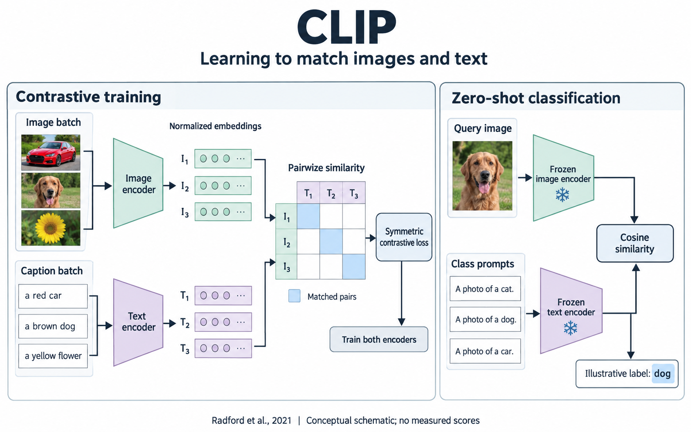

# Gallery notes and reproducible inputs

[English README](../README.md) · [中文 README](../README.zh-CN.md)

These four English cases ran on **2026-10-13** with Image2Editable v4.2.1. They test visual-target generation and restyling, not complete native reconstruction.

| Case | Input mode | Selected output | Required copy items | Original pixels |
|---|---|---|---:|---|
| [CLIP](../assets/gallery/clip.png) | New framework from checked paper content | Third local repair | 26 | 1586 × 992 |
| [Water in Motion](../assets/gallery/water-cycle.png) | New science explainer | First draft | 16 | 1586 × 992 |
| [Take the Long Way.](../assets/gallery/speaker.png) | Restyle an existing image | First draft | 7 | 1122 × 1402 |
| [After Dark](../assets/gallery/night-poster.png) | New concept poster | First draft | 7 | 1054 × 1492 |

Four initial built-in image-generation calls plus three CLIP repair calls were made. English wording was visually checked at original pixel detail; this is not an OCR/Unicode certificate. The host did not expose model/seed controls, so the prompts are inspectable inputs rather than a promise of pixel-identical regeneration.

## CLIP: scientific framework

[Image](../assets/gallery/clip.png) · [Brief](../examples/english-cases/clip/brief.json) · [Initial prompt](../examples/english-cases/clip/prompt.txt) · [Review](../examples/english-cases/clip/review.json)

Source: [Learning Transferable Visual Models From Natural Language Supervision, Radford et al., ICML 2021](https://proceedings.mlr.press/v139/radford21a.html). Figure 1 and the relevant method sections informed the content relationships. The generated car/dog/flower examples, three-pair batch, and dog label are illustrative; no measured scores are shown.

The first image had clear English labels but two connection defects: text embeddings entered the image-row header, and the inference result bypassed cosine similarity. Independent reading identified the issues. The selected revision separates training inputs at different matrix sides and preserves a dedicated similarity-to-label output.

| Initial draft | Selected revision |
|---|---|
|  |  |

Repair history:

1. [Repair 1](../examples/english-cases/clip/repair-01.txt): inference fixed, training input still incorrect.
2. [Repair 2](../examples/english-cases/clip/repair-02.txt): text reached the correct column axis, but image and text routes overlapped.
3. [Repair 3](../examples/english-cases/clip/repair-03.txt): move column labels below the matrix so text can enter from below without crossing the image route. Accepted as a conceptual visual target.

## Water in Motion: science explainer

[Image](../assets/gallery/water-cycle.png) · [Brief](../examples/english-cases/water-cycle/brief.json) · [Prompt](../examples/english-cases/water-cycle/prompt.txt) · [Review](../examples/english-cases/water-cycle/review.json)

Source: [USGS official water-cycle diagram](https://www.usgs.gov/media/images/water-cycle-png). The design selects evaporation, transpiration, condensation, precipitation, and infiltration, with surface water and groundwater for spatial context. It is schematic, not to scale, and does not represent the entire global water cycle.

The first draft retained the five process names, explanatory sentences, and correct directions. Its landscape treatment is more painterly than a flat infographic. No quantitative data or observational measurements are claimed.

## Take the Long Way.: product restyle

[Image](../assets/gallery/speaker.png) · [Brief](../examples/english-cases/speaker/brief.json) · [Prompt](../examples/english-cases/speaker/prompt.txt) · [Review](../examples/english-cases/speaker/review.json)

Inputs: an existing generated Chinese speaker visual plus a separate generated palette/typography study. The product is fictional. The task retains the woven face, champagne side shell, orange loop, and material details while replacing the copy with seven English items.

The first draft retained the product's recognizable features and produced a clear two-line English headline. The [portable image + text study](../examples/style-study-speaker/visual-spec.html) includes both actual inputs and their roles. Download the repository and open the HTML locally; GitHub does not execute this HTML as a hosted app.

## After Dark: event concept poster

[Image](../assets/gallery/night-poster.png) · [Brief](../examples/english-cases/night-poster/brief.json) · [Prompt](../examples/english-cases/night-poster/prompt.txt) · [Review](../examples/english-cases/night-poster/review.json)

Style reference: [NASA/JPL, The Grand Tour](https://www.jpl.nasa.gov/images/the-grand-tour-jpl-travel-poster/), studied for condensed titles, large-versus-small scale, and print-style information placement. The resulting subject, wording, event details, and composition are an original fictional concept, not a NASA event.

The first draft has clear title and logistics hierarchy and a plausible telescope-use pose. The concept footer is small and relatively quiet, so physical print readability still needs checking. Sky scale and motifs are expressive rather than an astronomical map.

## Editable renderer and catalog fixture

The separate [synthetic figure spec](../examples/renderer-demo/figure-spec.json) produces [SVG](../examples/renderer-demo/rendered/figure.svg) and [component/palette catalogs](../examples/renderer-demo/library/library.json) without image generation. It demonstrates executable geometry and object organization, not gallery-level visual quality or a scientific method.

This public package includes the SVG fixture and catalog, not a new native-application test. PPTX export is available when the optional host runtime is present. See the [runtime guide](runtime.md).

## Public packaging

Case briefs, prompt text, output hashes, and authored review summaries are included. Original paper PDFs, external reference PNGs, machine-specific call records, and private execution paths are not part of the public package. The CLIP, USGS, and JPL references remain linked at their original sources. The portable speaker study uses this project's generated reference assets and is self-contained.

The included prompts refer to their original numbered attachments. Re-running CLIP, water-cycle, or poster generation requires obtaining and inspecting the stated references, then supplying the images to a compatible tool. The speaker study includes its attachments. These notes distinguish inspected prompt evidence from a standalone batch-generation program.

## 中文说明

四张图来自同一轮英文视觉测试。它们展示的是完整视觉稿阶段，不是已完成的 PPTX／SVG 原生重建。CLIP 保留首稿、三轮修订提示词和最终审查摘要，其余三张采用首稿。这组案例不能当作语言对照或模型 benchmark。公开包附带一个可独立运行的合成 SVG／组件库示例，方便验证统一绘图 spec 的工作方式。
